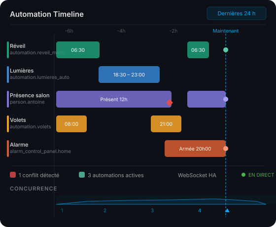

# ha-timeline-cards

Deux cartes Lovelace Home Assistant pour visualiser l'historique d'automations et de présence sous forme de timeline interactive.

[](https://hacs.xyz)
[](https://github.com/HOMELAB-IA/ha-timeline-cards/releases)
[](https://github.com/HOMELAB-IA/ha-timeline-cards/actions)



## Cartes incluses

### `automation-timeline-card`

Timeline horizontale des exécutions d'automations sur une période configurable.  
Affiche les déclenchements, les conflits et la concurrence en temps réel via WebSocket HA.

### `presence-timeline-card`

Timeline de présence par personne ou zone.  
Visualise les créneaux de présence/absence avec des blocs colorés et des indicateurs temps réel.

## Installation

### Via HACS (recommandé)

[](https://my.home-assistant.io/redirect/hacs_repository/?owner=HOMELAB-IA&repository=ha-timeline-cards&category=lovelace)

Ou manuellement :

1. Ouvrir HACS → **Frontend**
2. Cliquer les ⋮ → **Dépôts personnalisés**
3. Ajouter `https://github.com/HOMELAB-IA/ha-timeline-cards` — catégorie **Dashboard**
4. Chercher **Timeline Cards** et installer
5. Vider le cache du navigateur

### Installation manuelle

1. Télécharger [`ha-timeline-cards.js`](https://github.com/HOMELAB-IA/ha-timeline-cards/releases/latest/download/ha-timeline-cards.js)
2. Copier dans `<config>/www/`
3. Dans HA → **Paramètres → Tableau de bord → Ressources**, ajouter :
   ```
   /local/ha-timeline-cards.js
   ```
4. Vider le cache

## Configuration

### automation-timeline-card

```yaml
type: custom:automation-timeline-card
title: Automations du jour
hours: 24
entities:
  - automation.reveil_matin
  - automation.lumieres_auto
  - automation.volets
  - automation.alarme
```

### presence-timeline-card

```yaml
type: custom:presence-timeline-card
title: Présence
hours: 12
entities:
  - person.antoine
  - zone.home
```

## Prérequis

- Home Assistant ≥ 2024.1.0

## Licence

MIT
